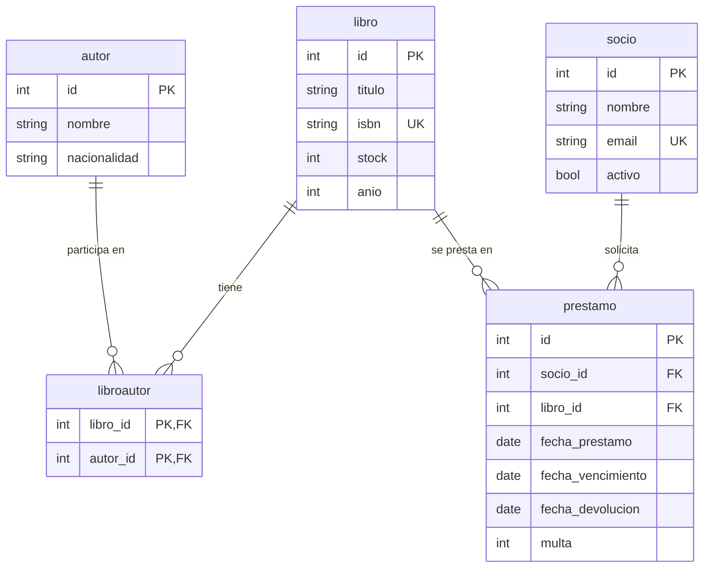

# Modelo de datos

El sistema tiene **cinco tablas** en SQLite. Cada una es una clase SQLModel dentro de `models/`. SQLModel nombra la tabla con el nombre de la clase en minúsculas: `autor`, `libro`, `libroautor`, `socio` y `prestamo`.

## Diagrama entidad-relación

## Relaciones

| Relación | Cómo se implementa |
|---|---|
| Libro N-N Autor | Tabla intermedia `libroautor` con clave primaria compuesta (`libro_id`, `autor_id`): impide asociar dos veces el mismo par. |
| Préstamo N-1 Socio | `prestamo.socio_id` es clave foránea de `socio.id`. |
| Préstamo N-1 Libro | `prestamo.libro_id` es clave foránea de `libro.id`. |

En el código, cada lado de la relación se navega con un atributo: `Autor.libros`, `Libro.autores`, `Libro.prestamos`, `Socio.prestamos`, `Prestamo.socio` y `Prestamo.libro`.

`Libro.autores` se carga siempre junto con el libro (`lazy="selectin"`): SQLAlchemy hace una consulta para los libros y **una sola más** para los autores de todos ellos, en lugar de una consulta por libro (el problema N+1). Los autores de cada libro se ordenan por `id`.

## Tablas

### autor (`models/autores.py`)

| Campo | Tipo | Restricciones |
|---|---|---|
| `id` | entero | Clave primaria. |
| `nombre` | texto | Obligatorio. Con índice (no único: puede haber autores homónimos). |
| `nacionalidad` | texto | Obligatorio. |

### libro (`models/libros.py`)

| Campo | Tipo | Restricciones |
|---|---|---|
| `id` | entero | Clave primaria. |
| `titulo` | texto | Obligatorio. Con índice. |
| `isbn` | texto | Obligatorio y **único** (índice único `ix_libro_isbn`). Se guarda normalizado: sin guiones ni espacios y con la X en mayúscula. |
| `stock` | entero | Obligatorio. `CHECK (stock >= 0)`. |
| `anio` | entero | Obligatorio. `CHECK (anio >= 1450)`. Además se valida que no supere el año actual (ver más abajo). |

### libroautor (`models/libro_autor.py`)

| Campo | Tipo | Restricciones |
|---|---|---|
| `libro_id` | entero | Parte de la clave primaria. Clave foránea de `libro.id`. La clave compuesta hace que asociar dos veces el mismo par responda 409. |
| `autor_id` | entero | Parte de la clave primaria. Clave foránea de `autor.id`. |

### socio (`models/socios.py`)

| Campo | Tipo | Restricciones |
|---|---|---|
| `id` | entero | Clave primaria. |
| `nombre` | texto | Obligatorio. Con índice. |
| `email` | texto | Obligatorio y **único** (índice único `ix_socio_email`). Su formato se valida con `EmailStr` y se guarda en minúsculas. |
| `activo` | booleano | Obligatorio. Valor por defecto `True` (lo asigna Python al crear el objeto). Un socio inactivo no puede pedir préstamos. |

### prestamo (`models/prestamos.py`)

| Campo | Tipo | Restricciones |
|---|---|---|
| `id` | entero | Clave primaria. |
| `socio_id` | entero | Obligatorio. Clave foránea de `socio.id`. |
| `libro_id` | entero | Obligatorio. Clave foránea de `libro.id`. |
| `fecha_prestamo` | fecha | Obligatoria. |
| `fecha_vencimiento` | fecha | Obligatoria. La calcula la capa de servicios (fecha del préstamo + 14 días). |
| `fecha_devolucion` | fecha | Opcional (`NULL`). Un préstamo está **activo** mientras sea nula. |
| `multa` | entero | Obligatoria. Valor por defecto `0`. La calcula la capa de servicios al devolver ($100 por día de atraso). |

La tabla no guarda si el préstamo está vencido ni cuántos días de atraso lleva: son datos que cambian cada día, así que se calculan al responder (ver más abajo). Lo único que se persiste al devolver es `fecha_devolucion` y `multa`.

## Dos niveles de protección de los datos

Los datos se protegen en dos lugares, y cada uno cubre algo distinto:

| Nivel | Dónde vive | Qué hace |
|---|---|---|
| Validación | Clases `...Base` (`LibroBase`, `SocioBase`, ...) | Controla lo que llega por la API (por ejemplo `stock >= 0` y año entre 1450 y el año actual). Responde 422 antes de tocar la base. Se aplica en los esquemas de entrada (`...Crear` y `...Actualizar`). |
| Restricción | La propia base de datos | Garantiza que ningún dato inválido quede guardado aunque se omita la validación: unicidad de `isbn` y `email`, `CHECK` de `stock` y `anio`, claves foráneas y clave primaria compuesta. |

Las clases que son tabla (`table=True`) **no ejecutan** las validaciones de sus campos al crear un objeto en Python; por eso las reglas esenciales se repiten como restricciones en la base. El año máximo del libro no tiene `CHECK` porque cambia con el tiempo: se valida solo en la capa de la API.

Las claves foráneas se hacen cumplir porque cada conexión activa `PRAGMA foreign_keys=ON` (SQLite las ignora por defecto). Ver [decisiones de diseño](decisiones-de-diseno.md).

## Esquemas de la API

Cada entidad tiene, además de su tabla, clases que definen lo que entra y lo que sale por HTTP. Viven en el mismo archivo que el modelo.

| Clase | Rol | Ejemplo |
|---|---|---|
| `...Base` | Campos y reglas compartidos | `AutorBase` |
| (la tabla) | Lo que se guarda en la base | `Autor` |
| `...Crear` | Entrada del alta (`POST`): sin `id` | `AutorCrear` |
| `...Actualizar` | Entrada del `PATCH`: todos los campos opcionales | `AutorActualizar` |
| `...Leer` | Salida: los campos más el `id` | `AutorLeer` |

`LibroLeer` suma además el campo `autores`, una lista de `AutorLeer` (`id`, `nombre` y `nacionalidad`), de modo que toda respuesta de libro incluye sus autores. `AutorLeer` no incluye los libros del autor (evita referencias circulares); se consultan con `GET /autores/{autor_id}/libros`.

`PrestamoCrear` solo tiene `socio_id` y `libro_id`: las fechas y la multa las decide el servidor. Si el cuerpo trae otros campos, se ignoran. `PrestamoLeer` repite los campos de la tabla y suma dos datos calculados al responder: `vencido` (verdadero solo si el préstamo sigue sin devolverse y ya pasó su vencimiento) y `dias_atraso` (los días transcurridos después del vencimiento: hasta hoy si está activo, o hasta la devolución si ya se devolvió).

### Reglas de validación de los campos

Las define `models/comunes.py`. Si no se cumplen, la API responde 422.

| Campo | Regla |
|---|---|
| `nombre` (autor y socio) | Texto de 2 a 100 caracteres. |
| `titulo` | Texto de 1 a 200 caracteres. |
| `nacionalidad` | Texto de 2 a 60 caracteres. |
| Todos los textos | Se recortan los espacios al inicio y al final; un texto que queda vacío se rechaza. |
| `isbn` | 10 caracteres (los 9 primeros dígitos y el último dígito o X) o 13 dígitos. Se aceptan guiones y espacios, que se eliminan. No se valida el dígito verificador. |
| `email` | Formato de email válido. Se recorta y se pasa a minúsculas. |
| `stock` | Entero mayor o igual a 0. |
| `anio` | Entero entre 1450 y el año actual. |
| `activo` | Booleano; vale `true` si no se envía. |

En el `PATCH` rige lo mismo para los campos enviados, y un campo enviado con valor `null` se rechaza (422), porque ningún campo de las tablas admite nulos.
